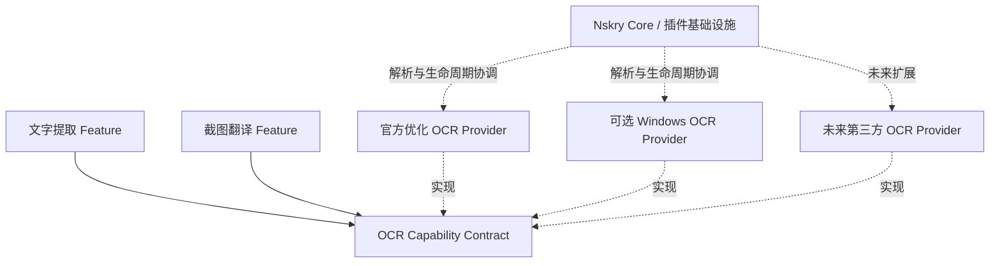
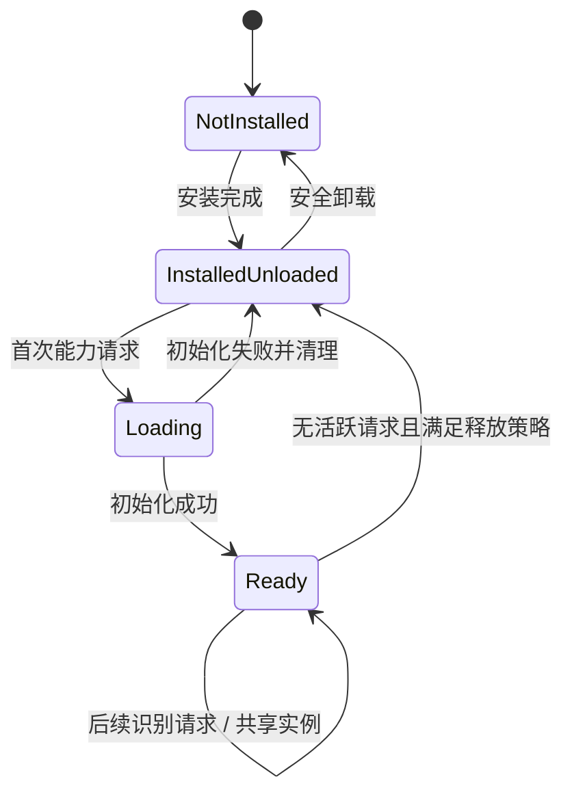

# Nskry 插件能力共享架构优化规范

> 文档用途：作为 Coding Agent 的开发 Context 与实施约束。
>
> 状态：产品与架构方向已确认；具体实现方式须结合当前仓库审查确定。
>
> 本次重点：将 OCR 的共享识别能力与用户侧文字提取功能解耦，使截图翻译复用高质量 OCR，同时保持 Nskry 轻量、开放、可选安装的产品定位。

## 1. 背景与问题

Nskry 是一个以轻量、开放、可扩展为目标的截图软件。软件本体提供必要的基础能力，其他功能通过可选插件提供。项目已有文字识别（OCR）插件，经过持续优化，识别效果已达到较好的水平；随后开发的截图翻译插件，为避免依赖完整 OCR 插件，独立实现了调用 Windows OCR 的逻辑，但识别效果不及已有的优化方案。

现有设计面临以下矛盾：

- 翻译插件单独维护 OCR 实现，会造成识别体验不一致、重复维护，并可能重复加载资源。
- 将高质量 OCR 实现复制进翻译插件，会产生代码、模型或运行资源重复的风险。
- 强制翻译插件依赖完整文字提取插件，会使仅需要翻译功能的用户被迫安装不需要的用户功能。
- 将 OCR 直接纳入 Core，会扩大基础软件的职责和潜在资源成本。

这里必须区分两种需求：截图翻译在当前 OCR → 文本翻译流程中需要文字识别**能力**，但不必然需要独立的文字提取、复制或导出**功能**。不能以用户群体可能重叠作为强制绑定功能插件的依据。

本次选择已确认的方案 C：**功能独立、能力共享、实现可替换**。将现有高质量 OCR 能力作为可复用、可选安装、按需加载的 Provider，由文字提取与截图翻译分别消费。

## 2. 设计目标与长期约束

以下原则适用于本次优化，也应成为后续官方及第三方插件设计的指导原则。

| 原则 | 含义 |
| --- | --- |
| 功能独立 | 用户只需选择自己需要的用户功能，不应仅为获取底层能力而被强制安装无关的用户功能。 |
| 能力共享 | 多个功能消费相同底层能力时，优先复用成熟实现；避免不必要的代码、模型和运行实例重复。 |
| 依赖抽象 | 功能模块应依赖明确的能力契约，而非另一个功能模块的 UI、内部类或私有实现。 |
| 实现可替换 | 在满足接口版本及实际能力要求的前提下，允许更换官方或第三方 Provider。 |
| 核心最小化 | 某项能力被多个插件使用，不代表必须将其纳入 Core。Core 可以负责能力发现与生命周期管理，但不应承担具体 OCR 算法。 |
| 前置组件合法 | 专门提供必要共享能力、不强制引入无关用户功能的前置组件允许作为依赖。 |
| 按需安装 | 由安装器或插件管理机制解析并呈现必要依赖，用户无需手动寻找前置组件。 |
| Installed != Loaded | 安装不等于加载；未实际使用的 Provider 不应仅因已安装而初始化重型资源或长期驻留。 |
| 低耦合、高内聚 | 模块围绕单一职责组织，跨模块协作通过最小公开契约完成，避免循环依赖和泄漏内部实现。 |
| 渐进演进 | 优先解决已出现的 OCR 共享问题；不为了预想的插件生态引入没有当前需求支撑的复杂系统。 |

这些原则并不意味着禁止所有插件间依赖，也不意味着每个内部函数都必须成为 Provider。如果一个功能确实需要另一项完整用户功能，且没有合理的能力拆分边界，可以评估显式功能依赖，但须记录必要性、安装影响及替代方案。仅为共享 OCR 能力而强制安装文字提取功能不属于此类情况。

## 3. 目标架构

### 3.1 模块角色

| 角色 | 职责 | 本次示例 |
| --- | --- | --- |
| Core | 基础截图能力、现有插件基础设施、必要的依赖解析及生命周期协调 | Nskry 本体 |
| Capability Contract | 定义稳定的能力接口、输入输出及兼容性边界；不包含重型实现 | OCR 能力契约 |
| Provider | 提供可复用能力及其具体实现；不强制引入独立用户功能 | 官方优化 OCR Provider、可选 Windows OCR Provider |
| Feature Plugin | 面向用户的工作流、入口、快捷键、展示及交互 | 文字提取插件、截图翻译插件 |

这些是逻辑职责，不要求每个角色一定对应独立进程、仓库、SDK 或 DLL。Provider 可以采用现有插件框架支持的组件类型或内部模块形式，最终应支持独立的安装/启用语义。实际部署边界由仓库现状、兼容性和测量结果决定。

### 3.2 依赖关系



关键边界：

- 文字提取插件不依赖截图翻译插件，截图翻译插件也不依赖文字提取插件。
- 两个 Feature 均通过 OCR 能力契约获取服务，不直接访问某个 Provider 的私有类、文件布局或算法实现。
- Provider 不反向依赖使用它的 Feature，不注册文字提取专属 UI 或快捷键；必要的诊断和 Provider 配置不等于独立用户功能。
- Core 负责基础设施，不内置高质量 OCR 算法、模型或文字提取工作流。
- 契约和运行时实现应避免造成循环依赖；若现有项目中已有等价接口或服务注册设施，优先复用而非新建平行系统。

### 3.3 各模块的具体职责

**官方优化 OCR Provider**：承接现有 OCR 插件中可复用的图像预处理、语言与识别参数、识别引擎、自动缩放、多轮识别、空间对齐、候选仲裁、未覆盖区域补入、结果整理及必要的诊断能力（以仓库实际实现为准）。这些处理应保持原有语义及质量，不应在迁移过程中重新退化为简单 Windows OCR 调用。

**文字提取 Feature**：保留原有截图文字识别入口、快捷键、用户可见设置、结果展示、选择、复制或导出等实际已有功能；通过 Provider 获取识别结果。不要求为了迁移而新增尚未存在的 UI 功能。

**截图翻译 Feature**：获取截图、请求 OCR、处理识别结果、调用现有翻译逻辑并展示翻译结果；不再维护一套重复的高质量 OCR 实现。翻译 API、语言选择、交互及已有翻译设置原则上保持不变。翻译引擎将来可以成为独立 Provider，但不是本次必须拆分的范围。

**Windows OCR Provider（可选）**：若当前翻译插件的 Windows OCR 实现适合复用，可将其迁移到同一契约下，作为轻量实现、测试替身之外的真实替代实现或显式备用选项。不是必须与官方优化 Provider 同时安装，也不应因迁移导致用户默认获得较差的识别结果。

## 4. 能力接口与 Provider 解析

### 4.1 最小 OCR 契约

先审查两个现有插件真实的输入输出，再定义共享契约。以下为语言无关的概念示意，**不是要求新增这些精确名称、字段或序列化格式**：

```text
OcrRequest:
  image               # 截图数据或受控图像句柄
  languageHints?      # 可选语言提示 / 自动识别策略
  options?            # 经实际需求验证的通用识别选项

OcrResult:
  text                # 识别出的原文
  regions?            # 文本区域及坐标，若现有 Feature 需要
  detectedLanguage?   # 仅当实现能够可靠提供
  warnings?           # 部分结果或能力限制等

OcrProvider:
  recognize(request, cancellation) -> OcrResult / structured error
```

契约设计要求：

- 支持现有文字提取与截图翻译真正需要的结果格式。若翻译需要行、块、阅读顺序或坐标，必须保留相关语义，不得将结果一律压平成字符串。
- 明确图像所有权、缓冲区生命周期、坐标系、取消、超时、线程安全、并发行为及失败语义；不要让消费者接触 Provider 私有识别中间态。
- 区分识别为空、输入无效、语言不支持、Provider 不可用、取消、超时和识别失败；不把失败伪装成成功空结果。
- 置信度、语言检测等字段仅在引擎能够提供时返回；不得伪造质量指标或识别结果。
- Provider 专属调优参数、trace 和模型配置留在实现侧或独立诊断接口，避免将算法细节固定为通用契约。
- 按实际语言和运行环境决定同步/异步形式、对象所有权和 ABI/协议；优先与现有 SDK 一致。

### 4.2 声明与解析

逻辑上，消费者声明对 `ocr` 能力的依赖，Provider 声明自己提供的能力、契约版本以及必要的兼容信息。以下仅用于说明目标语义，不代表项目已经支持该 manifest 格式：

```yaml
# Feature: 截图翻译（示意）
kind: feature
requires:
  - capability: ocr
    contractVersion: "1"

# Provider: 官方优化 OCR（示意）
kind: provider
provides:
  - capability: ocr
    contractVersion: "1"
```

若现有框架暂时只支持按包 ID 声明依赖，可以在首期由官方 Provider 包承担默认依赖，同时保持消费端代码面向能力契约，并记录后续能力解析扩展点。不要为实现形式上的通用性一次性重写整个插件管理器。

解析行为应满足：

1. 从可用、兼容且受信任的 Provider 中解析满足当前 Feature 要求的实现；默认推荐官方优化 OCR。
2. 已有可用实现应复用，不应无条件安装重复的默认实现；用户显式选择的 Provider 在满足要求时优先。
3. 版本、平台、语言或必要输出能力不兼容时，给出明确的原因和修复路径；不能仅根据 `ocr` 名称判断兼容。
4. 没有可用实现时提示安装/修复必要依赖，不允许 Feature 无提示失败或悄悄切换到效果较差的引擎。
5. 若实现自动 fallback，必须有明确策略，能反映实际使用的 Provider，且避免掩盖错误或隐私边界变化。首期可以不实现自动 fallback。
6. 多 Provider 注册、动态切换、第三方安装、复杂版本求解均属渐进目标；没有现实需求时不必在本次全面实现。

第三方 Provider 的可信来源、权限、签名、进程隔离、网络访问与隐私应沿用现有安全策略；不能因共享能力机制而默认允许向外部服务发送截图或文本。如果未来提供云 OCR，需明确用户授权和数据流向。

## 5. 安装、卸载与升级语义

用户看到的是所需功能，而不是被要求自行理解技术依赖。依赖组件可在详情中明确展示，并由现有安装器或插件管理器处理；安装必要组件应遵循已有用户确认及权限规则。

| 用户选择 | 功能组件 | 必要 OCR 能力组件 |
| --- | --- | --- |
| 仅基础截图 | 无额外 OCR Feature | 无 |
| 仅文字提取 | 文字提取 | 一个兼容 Provider |
| 仅截图翻译 | 截图翻译 | 一个兼容 Provider |
| 两者均安装 | 文字提取、截图翻译 | 默认共享一个满足双方需求的 Provider |

这里的“一个”是共享优先的目标，并不禁止用户显式安装多个 Provider，或因功能要求不同而需要多个实现。

卸载时依据实际依赖关系与用户的显式安装意图处理：删除文字提取但保留翻译时，不应删除翻译仍需要的 Provider；反之亦然。若移除正在被依赖的 Provider，应阻止导致不可用的卸载，或在用户知情下先切换兼容实现。无依赖且仅作为自动安装前置的 Provider，可按项目策略提示清理；不要误删用户显式保留的组件、配置或其他消费者仍需的文件。安装失败、升级失败及部分依赖变更应尽可能可恢复，避免留下损坏的插件状态。

迁移既有用户时，应审查原 OCR 插件 ID、安装记录、配置、快捷键、版本与更新渠道。已有文字提取功能应继续可用；原本只安装翻译插件的用户不得被静默启用文字提取功能。迁移前应处理依赖版本兼容和失败回滚，避免新旧实现同时初始化。保留现有外部兼容边界，必要时使用临时兼容适配层，并明确何时删除。

## 6. 运行时资源与生命周期

遵守既有 `Installed != Loaded` 原则。共享 Provider 的目标是减少不必要的资源消耗，并非保证任何拆分都自动降低内存。



实现要求：

- 发现或读取 Provider 元数据不应触发重型引擎、模型、后台线程或工作进程初始化。
- 请求到达时才按需初始化；并发首次请求避免重复创建实例，确保取消单个调用不影响其他活跃调用。
- 相同兼容实现、配置及运行边界下，优先共享引擎或模型资源；是否能共享同一对象实例取决于现有进程、线程安全和 ABI 约束。不能为了单实例而破坏隔离或并发安全。
- Provider 释放应确保不存在正在执行的识别任务；按需要采用引用计数、租约、空闲释放或现有生命周期机制，不强制立即卸载每次调用后的 DLL。
- 如果运行时无法可靠回收某些原生资源，需说明限制及替代方案，不能宣称已完全卸载。
- 空闲缓存策略应平衡冷启动、重复识别延迟和 RAM；不引入未经测量的常驻预热机制。
- 不因为本次共享 OCR 就强制创建全新的常驻服务或改变整个软件的进程架构。

性能判断必须基于实测：磁盘占用、后台空闲 RAM、OCR 首次调用时延、重复调用时延、峰值内存、任务结束后的资源状态，以及两个 Feature 连续/并发使用时的实例或模型加载次数。采用相同设备、输入、配置和测量口径对照重构前后。若出现退化，应报告幅度、原因和取舍；没有既有预算时先建立基线，不凭空设定毫秒或 MB 门槛。

## 7. 实施顺序（Coding Agent）

### Phase 0 — 仓库审查与基线（必须先执行）

阅读现有项目文档、Core、插件 SDK、插件管理与加载机制、安装/更新逻辑，以及 OCR 和翻译插件的代码、测试和历史验收样例。确认当前真实语言、构建方式、接口、模块边界、依赖图与 OCR 优化流水线。

输出简明的审查结论：可复用 OCR 逻辑位于何处；哪些部分与 UI 或宿主耦合；当前翻译如何调用 Windows OCR；两者输入输出有何差异；现有框架是否支持依赖安装、能力注册、延迟加载、资源释放；拟修改模块/文件及迁移风险。建立可复现的质量与资源基线；历史难图若可获得则纳入回归集。

不得在未审查前假定现有架构、真实文件路径、具体 API 或可用依赖管理功能。若缺少关键测试资源或目标平台环境，记录缺失项并先完成可验证部分。

### Phase 1 — 抽取契约与成熟 OCR 实现

确定最小共享契约及模块边界，将当前经过优化的 OCR 识别流水线迁移或封装为可复用实现。尽量采用移动、封装和适配，而不是重写算法。将文字提取专属交互留在 Feature。保留现有配置语义、识别结果、诊断及测试能力；先让原文字提取功能通过共享接口正常工作，并完成回归测试。

### Phase 2 — 接入截图翻译

将翻译插件的 OCR 调用迁移到同一契约，默认使用官方优化 Provider。在尽量不改变翻译工作流的前提下处理文字块、顺序及必要坐标。删除不再需要的重复逻辑；如保留 Windows OCR，需以明确的可替换实现存在，而非继续维护一条隐藏的低质量默认路径。验证仅安装翻译时的行为。

### Phase 3 — 依赖安装与生命周期整合

根据现有能力，逐步补齐共享组件的独立安装、依赖解析、卸载保护、延迟初始化及资源管理。若安装器或通用插件管理器尚未成熟，可先以最小兼容机制完成当前两个插件的解耦，但必须说明哪些独立安装行为尚未实现，不得将临时的完整 OCR Feature 依赖宣称为最终方案 C。最终达到第 5、6 节语义后才能标记对应目标完成。

### Phase 4 — 回归、测量与文档

验证完整安装组合、失败场景、升级/卸载、OCR 质量及后台资源。更新受影响的项目架构、插件开发规则、Provider 接口文档与用户安装说明。清理确认已无消费者的重复代码和依赖，避免删除仍需兼容的公共接口。

每阶段优先保持可构建、可测试和可回退。遇到与既有项目约束冲突的重大设计选择（例如必须改变公开 SDK、引入常驻进程或迁移用户数据），先报告冲突、备选方案及影响，避免未经确认扩大重构范围；其他无阻塞部分继续实施。

## 8. 验收标准

以下是最终目标的可验证验收项，不是对当前版本已经达标的声明。Agent 应逐项给出实际测试证据或标记未验证/未完成。

| ID | 验收项 | 验证方法与通过条件 |
| --- | --- | --- |
| A01 | Core 保持最小化 | 仅安装基础软件可正常截图；无需安装、初始化 OCR 实现或模型。 |
| A02 | 文字提取独立 | 只安装文字提取及必要 Provider 即可完成原有工作流，不依赖翻译插件。 |
| A03 | 翻译独立 | 只安装翻译及必要 Provider 即可截图翻译，无须安装或启用完整文字提取 Feature。 |
| A04 | 成熟 OCR 复用 | 两个 Feature 默认经同一能力契约使用官方优化流水线，而非各自复制算法。通过调用链、模块依赖及测试验证。 |
| A05 | OCR 质量回归 | 使用迁移前相同输入与设置比较原文、区域和阅读顺序等实际输出；现有通过样例不得无故退化。记录旧有失败样例，不把迁移前未解决的问题误标为新架构回归。 |
| A06 | 翻译端到端 | 验证截图 → OCR → 文本翻译 → 结果呈现；保留既有语言选择、交互及错误反馈。 |
| A07 | 可替换契约 | 使用测试 Provider/适配器验证替换实现不要求修改 Feature 业务逻辑；若已有 Windows Provider 则追加真实切换验证。 |
| A08 | 兼容性及失败处理 | 缺失/不兼容 Provider、初始化失败、空文本、取消、超时等情况有明确行为，基本截图功能不被破坏。 |
| A09 | 共享安装 | 在安装两个 Feature 时，共享满足双方需求的 Provider，不重复安装同版本共享实现。 |
| A10 | 安全卸载 | 卸载其中一个 Feature 不破坏另一个；不移除仍在使用的 Provider；无依赖时遵循清理策略。 |
| A11 | 按需加载 | 已安装但未调用时不初始化重型 OCR 资源；使用时按需初始化。以日志、实例计数或资源测量证明。 |
| A12 | 运行资源复用 | 在兼容运行边界下避免重复初始化；若无法共享实例，报告原因和实测成本。并发请求和释放过程无明显生命周期错误。 |
| A13 | 性能基线 | 提供同条件重构前后磁盘、RAM、时延与峰值资源对比；解释退化及剩余限制，不仅给出理论分析。 |
| A14 | 迁移兼容 | 验证适用的原插件升级路径、用户配置及快捷键保留、失败恢复；未实现的安装器相关功能单独标记。 |
| A15 | 架构与构建 | 无新的循环依赖或不必要的 Core 算法依赖；现有构建和相关测试通过；新增契约与生命周期测试及维护文档。 |

建议覆盖正常截图、低分辨率/小字号、多语言、复杂布局、空白区域、连续调用、并发调用和 Provider 不可用等场景。具体样例依据现有回归集及两种 Feature 的真实需求选定，不应用硬编码词典或特定样例输出掩盖识别回归。

## 9. 非目标与禁止事项

- 不将所有现有插件强制重写成 Provider + Feature；只有存在合理共享边界时才拆分。
- 不把完整通用能力市场、自动下载平台、跨进程 RPC、动态热插拔、复杂依赖求解或云服务当成本次前置条件。
- 不为了概念纯粹性新增大量薄包装模块或抽象没有现实需求的能力。
- 不把 OCR 或翻译引擎直接强制打包进基础 Core，不复制已成熟的 OCR 算法进入翻译 Feature。
- 不以更换算法、删除多轮识别或降低准确率来获得表面上的轻量化；算法优化另行评估。
- 不无故改动插件 ID、用户配置、快捷键、翻译逻辑、UI 或公共接口；不引入隐式联网及未经授权的数据上传。
- 不把已安装组件自动视为必须常驻的组件；不承诺未经测量的性能收益。
- 不因 Provider 抽象存在就宣称第三方生态、动态切换、完全卸载或自动依赖管理已经实现。

## 10. Agent 最终交付要求

实施完成后，提交代码及必要的项目文档、测试和一份简明变更报告。报告至少包含：

1. 审查发现、重构前后依赖关系、实际模块/文件位置及关键设计选择。
2. OCR 流水线迁移情况、保留的优化项、默认 Provider 与 Windows OCR 的最终处置。
3. 文字提取与截图翻译的调用链、安装/卸载及运行时生命周期行为。
4. 构建命令、测试命令、运行结果、OCR 回归证据以及资源和性能对比。
5. A01–A15 验收状态（通过 / 失败 / 未验证 / 尚未实现）及证据；列出未解决问题、兼容风险与后续建议。
6. 本次没有实现的长期设计项、临时兼容方案及未来移除条件；说明与本规范不一致的决策及原因。

不要仅交付架构建议而不执行可行的重构；也不要仅以构建成功或代码抽取成功作为整个方案验收完成的依据。

## 11. 建议长期写入项目架构文档的核心声明

> Nskry 的轻量化不等于每个插件必须完全自给自足，而是用户只承担所选功能真正需要的安装和运行成本。用户功能之间保持独立，共享能力按需提供，具体实现通过稳定契约保持可替换。专门的前置能力组件是合法依赖，但不应为获取能力而强制安装无关用户功能。共享能力不自动归入 Core，已安装也不等于已加载。架构演进以真实需求、可验证的质量及资源成本为依据，避免过度设计。

---

**文档边界**：本规范基于已确认的产品和架构讨论编写，未直接审查当前代码仓库。图示、接口名、manifest 和组件名称均为目标语义示例，而非现有实现事实。Agent 必须以当前仓库为准，将上述原则落到现有技术栈；原有项目规划及无关插件开发继续有效，仅在与本规范明确冲突的范围内调整。
